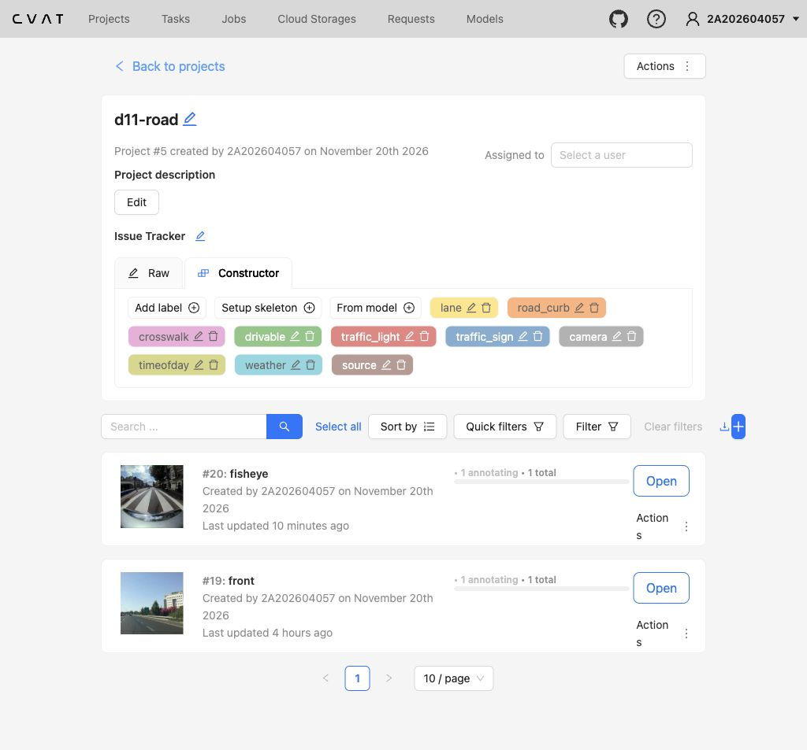
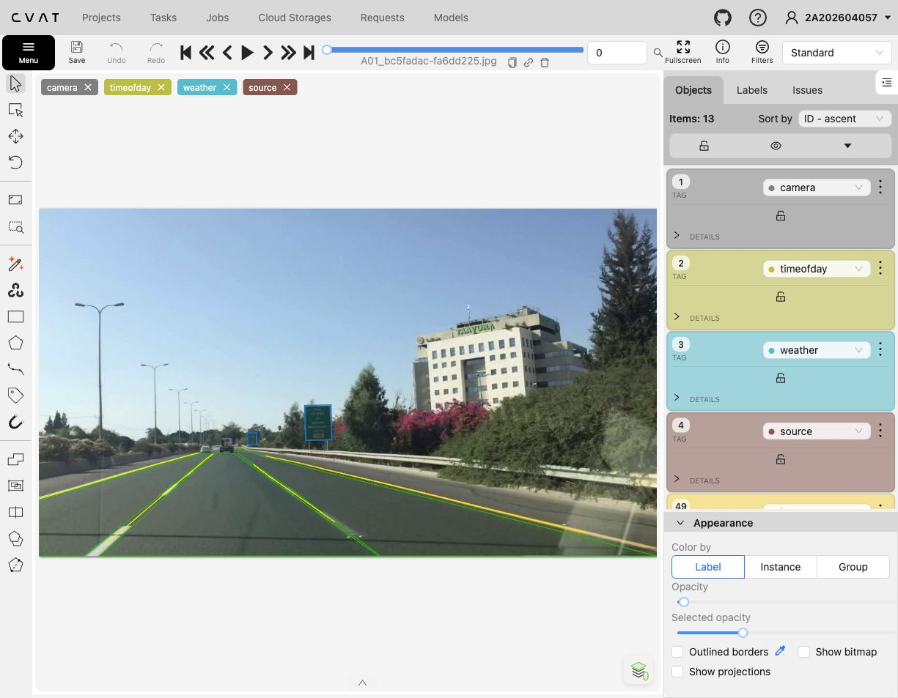
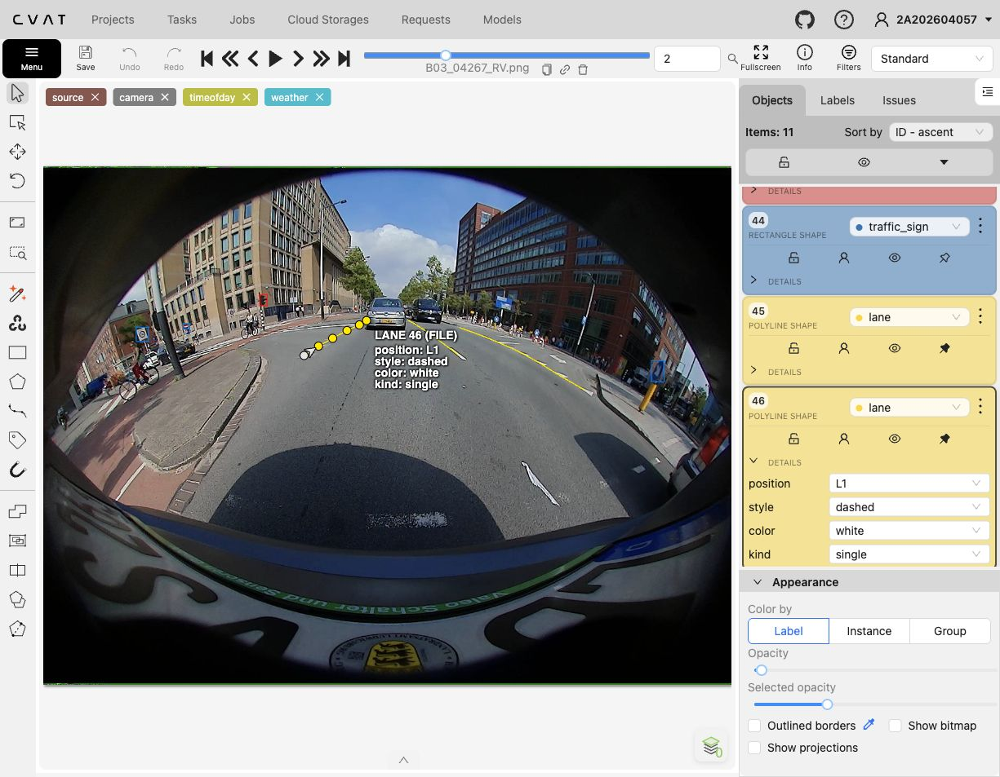
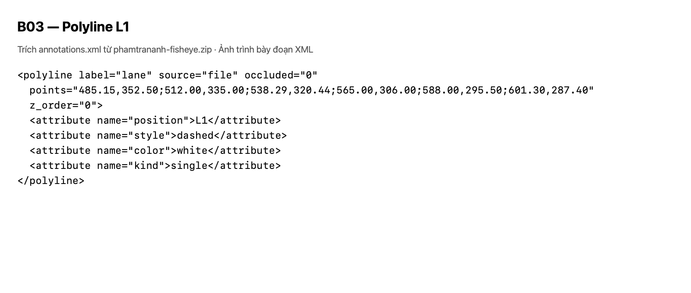
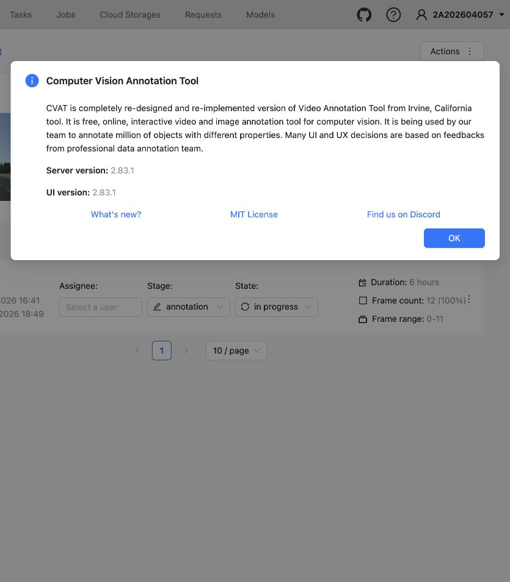

# Báo cáo cá nhân — Ngày 11

Họ tên Phạm Trần Anh. Mã học viên 2A202604057, xác định từ tài khoản trong metadata file front.

Ngày lập báo cáo 20/11/2026, cập nhật hồ sơ 21/11/2026. Guideline Road v1.0. Lần nộp dự kiến revision 1, theo manifest hiện tại. Chưa xác nhận số lần nộp lại sau Rework.

Phiên bản CVAT Server và UI đều là 2.83.1, đã xác nhận trực tiếp trong hộp thoại About. Định dạng XML là CVAT for images 1.1.

Metadata ghi thời điểm export front là 20/11/2026 lúc 18 giờ 49 phút và bản fisheye mới là 20/11/2026 lúc 22 giờ 37 phút, giờ Việt Nam. Bản fisheye đã được nhập vào task và export lại trên tài khoản 2A202604057. Các chỉnh sửa front được thực hiện cục bộ sau export. Đã mở A01 và B03 trong CVAT để chụp minh chứng hiển thị. Các ảnh còn lại cần được kiểm tra đầy đủ trước khi nộp.

**Chủ sở hữu task đã xác minh.** File fisheye mới được export từ CVAT với owner là 2A202604057, trùng tài khoản trong file front. Các nhãn fisheye có source="file", phản ánh thao tác nhập annotation vào task. Lô fisheye sử dụng nhãn có sẵn được nhập từ ZIP, sau đó được hỗ trợ rà soát và chỉnh sửa. Tọa độ và thuộc tính trong bản export mới khớp bản đã chỉnh trước khi nhập. Phần việc ban đầu của mỗi người cần được người học xác nhận và ghi nhận theo yêu cầu lớp. Metadata xác minh tài khoản sở hữu task, còn phần việc thực tế cần khai báo trong báo cáo.

## 1. Kiểm project

| Mục | Kết quả | Ghi chú |
| --- | --- | --- |
| 6 label, đúng kiểu | Đã kiểm tra trong XML của cả hai ZIP | lane và road_curb là polyline, crosswalk và drivable là polygon, đèn và biển là rectangle |
| Thuộc tính và giá trị | Lint hiện tại không báo lỗi cấu trúc thuộc tính | Giá trị có đúng cảnh trong ảnh vẫn cần người kiểm xác nhận |
| 4 tag ảnh | Đủ trên 20/20 ảnh | camera, timeofday, weather, source |

Cách kết thúc polyline và cách đặt tag trên bản CVAT đang dùng cần người học xác nhận thao tác thực tế. Theo hướng dẫn repo, kết thúc polyline bằng N và đặt tag bằng công cụ Tag, sau đó chọn thuộc tính value trong Details.

## 2. Số lượng nhãn trong bộ file bàn giao

Thống kê lấy trực tiếp từ hai ZIP hiện tại. Hai file có cùng tài khoản sở hữu task 2A202604057. Nguồn nhãn và phần việc của từng người được nêu ở phần đầu báo cáo.

| Task | Ảnh | lane | road_curb | crosswalk | drivable | traffic_light | traffic_sign |
| --- | ---: | ---: | ---: | ---: | ---: | ---: | ---: |
| front | 12 | 29 | 8 | 2 | 21 | 17 | 12 |
| front-extra | 0 | 0 | 0 | 0 | 0 | 0 | 0 |
| fisheye | 8 | 9 | 4 | 7 | 4 | 6 | 4 |
| fisheye-extra | 0 | 0 | 0 | 0 | 0 | 0 | 0 |

Tổng cộng 123 hình vẽ và 80 tag, tương ứng 203 nhãn trên 20 ảnh.

## 3. Bảng ca khó

| Ảnh | Nhãn | Phân vân giữa | Tình trạng hiện tại | Lý do / việc cần xác nhận |
| --- | --- | --- | --- | --- |
| A05 | lane L1, R1 | Bỏ sót vạch hoặc không có vạch nhìn thấy | Hai cảnh báo QC1-02 | Khi xem ảnh chưa thấy vạch sơn rõ, chờ coach xác nhận |
| A06 | lane R1 | Bỏ sót hoặc vạch bị che / không rõ | Một cảnh báo QC1-02 | Cần đối chiếu cảnh và yêu cầu ảnh với coach |
| A07 | lane L1 | Bỏ sót hoặc mép đường không sơn | Một cảnh báo QC1-02 | Cần phân biệt vạch sơn với mép dải phân cách |
| A08 | lane L1 | Vạch mờ hoặc thiếu nhãn | Một cảnh báo QC1-02 | Cần kiểm tra trực tiếp trên CVAT |
| B03 | lane L1 | Polyline thưa điểm ở đoạn cong | Đã chỉnh từ 3 thành 6 điểm theo ảnh | Cần xác nhận độ sát trong CVAT |
| B03 | traffic_sign | group và edge_zone | Đã chọn mandatory, edge_zone=true | Đối chiếu ảnh cho thấy biển hiệu lệnh xanh ở rìa |
| B04 | traffic_light | type và edge_zone | Đã chọn pedestrian, edge_zone=false | Đối chiếu ảnh cho thấy đèn người đi bộ |

## 4. Phiếu QC 1 nhận được và lịch sử sửa

Phiếu QC đính kèm trên repo là [leducthanh-qc1-for-phamtrananh.md](leducthanh-qc1-for-phamtrananh.md), với người kiểm Lê Đức Thanh và lô được kiểm của Phạm Trần Anh. Phiếu đang chờ người kiểm xác nhận kết quả. Phiếu `phamtrananh-qc1-for-leducthanh.md` được lưu trong hồ sơ cục bộ để đối chiếu lịch sử kiểm lô của bạn được ghép.

Đã nhận bản dự thảo `phamtrananh-qc1-for-leducthanh.md` để Phạm Trần Anh kiểm lô của Lê Đức Thanh, theo tên đã được Phạm Trần Anh xác nhận. Đây là phiếu kiểm lô của bạn được ghép. Phiếu ghi Rework cho revision 1, với 1 lỗi nặng, 7 lỗi chính, 1 lỗi nhẹ; tỷ lệ lỗi chính đã được tính lại thành 7/70 = 10,0% theo số shape và tag trong thống kê nguồn; tài liệu cho biết phần lớn lỗi đã được sửa ở revision 2 và còn drivable B02. Chưa đối chiếu các ZIP revision 1/2 của lô này. Phạm Trần Anh cần xác nhận các lỗi và ảnh B03 theo ghi chú của phiếu trước khi ký kết luận. Tên hai học viên đã được xác nhận là Phạm Trần Anh và Lê Đức Thanh.

Người kiểm bài được chỉ định là Lê Đức Thanh, lô được kiểm của Phạm Trần Anh. Phiếu `leducthanh-qc1-for-phamtrananh.md` đã được chuẩn bị theo đúng mẫu QC 1 của lab, căn cứ kết quả tự kiểm trước đó. Lê Đức Thanh cần xác nhận số ảnh, số nhãn đã kiểm, kết quả kiểm trực quan và quyết định cuối cùng. Bản dự thảo đang ghi Hold tạm thời vì các ca thiếu L1/R1 còn chờ xác nhận.

| Mã | Diễn biến | Đã xử lý |
| --- | --- | --- |
| QC1-02 / QC1-03 | A02 và A09 có vị trí lane cần chỉnh | Đã đổi position theo quan sát ảnh |
| QC1-05 / QC1-06 | A04, A09, A11 có các nét được nhận định thuộc cùng vạch đôi | Đã gộp bằng cách giữ một polyline có kind=double, xóa nét tương ứng và chỉnh thuộc tính |
| QC1-04 | A11 có đường vẽ từ xa về gần | Đã đảo thứ tự điểm |
| QC1-11 | B03 polyline thưa điểm và biển ở rìa, B04 đèn ở trong vùng 80% | Đã chỉnh điểm và edge_zone, fisheye hiện có 0 cảnh báo lint |
| QC1-02 | Còn 5 cảnh báo ở A05–A08 | Chờ coach xác nhận, người học yêu cầu chuyển sang chuẩn bị hồ sơ |

Các chỉnh sửa do Codex hỗ trợ bằng cách xem ảnh và sửa annotations.xml. Đã quan sát A01 và B03 trên giao diện CVAT, B03 hiển thị polyline L1 với 6 điểm và các thuộc tính dashed, white, single. Chưa đối chiếu GT và chưa xác minh toàn bộ sai lệch 5 px. Bản fisheye đã được export lại và kiểm tra khớp tọa độ, thuộc tính với bản đã sửa.

## 5. Kiểm file export

| File | Đọc lại ZIP/XML được? | Số shape ảnh 1, job / file | Số shape ảnh 2, job / file | Tag camera có trong XML? |
| --- | --- | --- | --- | --- |
| phamtrananh-front.zip | Có | Job A01 có 13 mục gồm 4 tag, suy ra 9 shape / file có 9 |  Job A02 có 5 shape và 4 tag / A02 có 5 | Có, đủ 12 ảnh |
| phamtrananh-fisheye.zip | Có | 3 shape và 4 tag / B01 có 3 | Có 5 shape và 4 tag / B02 có 5 | Có, đủ 8 ảnh |

Manifest phamtrananh-manifest.json đã được kiểm tra khớp SHA-256 và kích thước các ZIP hiện tại. contains_images=false cho cả hai file. Kết quả lint chung là 20 ảnh, 5 cảnh báo mức nặng theo bộ kiểm tra, 0 chính, 0 nhẹ. Các cảnh báo còn lại đang chờ xác nhận bằng mắt.

Theo xác nhận của Phạm Trần Anh, các job của hai task front và fisheye đã được chuyển sang Completed. Ảnh minh chứng được chụp trước khi cập nhật trạng thái. Nếu xuất lại ZIP có thay đổi nội dung, cần tạo lại manifest tương ứng.

## 6. Ảnh chụp màn hình

Đã chụp trực tiếp project và trình gán nhãn CVAT. Ảnh XML được dựng từ đoạn trích thực tế trong ZIP và có chú thích nguồn.

### 6.1. Bộ Labels của project #5



### 6.2. Ảnh A01 trên CVAT

Ảnh front hiển thị các polyline lane, vùng drivable, hộp traffic_sign và bốn tag. Job có 13 mục gồm 9 hình vẽ và 4 tag.



### 6.3. Polyline L1 trên ảnh B03

Đường L1 được chọn trên ảnh fisheye, hiển thị 6 điểm và các thuộc tính position=L1, style=dashed, color=white, kind=single. Ảnh chụp cho thấy các điểm điều khiển và bảng Details.



### 6.4. Đoạn XML chứa polyline lane

Ảnh dưới trình bày đoạn XML trích trực tiếp từ annotations.xml trong phamtrananh-fisheye.zip. Định dạng chữ được dựng để đọc rõ nội dung. Nội dung XML tương ứng cũng được giữ dưới ảnh để đối chiếu.



### 6.5. Phiên bản phần mềm



```xml
<polyline label="lane" source="file" occluded="0"
  points="485.15,352.50;512.00,335.00;538.29,320.44;565.00,306.00;588.00,295.50;601.30,287.40"
  z_order="0">
  <attribute name="position">L1</attribute>
  <attribute name="style">dashed</attribute>
  <attribute name="color">white</attribute>
  <attribute name="kind">single</attribute>
</polyline>
```

## 7. Tự đánh giá

Từ kết quả kiểm và các chỉnh sửa, các mục cần chú ý là xác định position của lane, biểu diễn vạch đôi, chiều đặt điểm và số điểm trên cung fisheye. Ở buổi sau cần đối chiếu thuộc tính của từng đường ngay sau khi vẽ và dành thời gian self-QC trước export.

Polyline cung cấp tọa độ mục tiêu cho model phát hiện làn. Chẳng hạn, gán nhầm vạch bên phải thành L1 làm sai ý nghĩa vị trí tương đối với làn xe. Polyline ít điểm trên cung cong có thể làm đường huấn luyện lệch tâm vạch giữa các điểm.

Nội dung tự đánh giá được soạn từ kết quả kiểm file, người học cần đọc và xác nhận trước khi nộp.

## 8. Hoạt động row-anchor tùy chọn

Ảnh so sánh A01_bc5fadac-fa6dd225.jpg, vạch lane position=R1, kích thước 1280 × 720 px. Số liệu Phạm Trần Anh được tính bằng road_lab.rowanchor từ phamtrananh-front.zip hiện tại. Số liệu Lê Đức Thanh do Phạm Trần Anh cung cấp trong trao đổi, được dùng cho cùng ảnh và vạch theo kế hoạch so sánh. Chưa đối chiếu số liệu này với ZIP của Lê Đức Thanh và chưa xác định revision tương ứng của bạn được ghép.

| y | 720 | 680 | 640 | 600 | 560 |
| --- | ---: | ---: | ---: | ---: | ---: |
| x của chúng tôi — Phạm Trần Anh | không có làn | không có làn | 599.4 | 542.6 | 484.5 |
| x của bạn kia — Lê Đức Thanh | không có làn | không có làn | 603.8 | 544.7 | 484.6 |
| Độ lệch tuyệt đối, px | Không tính | Không tính | 4.4 | 2.1 | 0.1 |

Các độ lệch được tính từ giá trị x làm tròn một chữ số thập phân trong bảng. Cụm “không có làn” là đầu ra của script khi hàng y nằm ngoài polyline được gán.

Lệnh dùng để lấy số liệu bài Phạm Trần Anh như sau.

```bash
PYTHONPATH=src python3 -m road_lab.rowanchor phamtrananh-front.zip --image A01 --position R1
```

**1. Nếu dừng polyline sớm 40 px, hàng nào đổi thành “không có làn”?**

Với giả định 40 px được tính theo trục dọc y và rút ngắn ở đầu xa, polyline R1 hiện đi từ y=649.39 đến y=529.73. Điểm dừng xa mới là y=569.73. Hàng y=560 sẽ đổi thành “không có làn”; y=600 và y=640 vẫn có giao điểm. Hai hàng y=680 và y=720 vốn đã nằm ngoài đoạn được gán. Kết quả này áp dụng cho giả định độ ngắn theo trục y; nếu đo 40 px dọc chiều dài đường cong thì cần tính lại điểm dừng.

**2. Hai người lệch nhau bao nhiêu tại y=720 và y=560? Hàng nào ảnh hưởng LKA nhiều hơn?**

Ở y=720, cả hai bài đều không có giao điểm được gán nên không tính được độ lệch x. Ở y=560, độ lệch tuyệt đối là |484.5 − 484.6| = 0.1 px.

Về vai trò hình học, hàng gần đáy ảnh như y=720 thường mô tả vùng đường gần xe và có liên quan trực tiếp tới việc ước lượng vị trí xe trong làn cho chức năng hỗ trợ giữ làn LKA. Bảng hiện tại chưa có dữ liệu ở y=720 để so sánh sai lệch của hai bài tại hàng này. Đây là giải thích tổng quát, chưa đối chiếu nội dung slide 25 của lớp và chưa lượng hóa tác động lên một bộ điều khiển LKA cụ thể.

**3. Đảo chiều polyline có thay đổi phép tính không? Script nào sẽ gặp khó?**

Với polyline này, đảo thứ tự các đỉnh giữ nguyên đường hình học và các giao điểm x tại năm hàng y. Hàm geometry.x_at_y kiểm tra đoạn bằng min(y1, y2), max(y1, y2), nên rowanchor vẫn trả cùng kết quả; đã kiểm tra lại bằng cách đảo danh sách điểm.

Quy tắc vẽ từ gần xe ra xa vẫn cần tuân thủ. road_check lint kiểm tra thứ tự điểm đầu và điểm cuối nên sẽ cảnh báo QC1-04 khi đảo ngược. Khi chấm bằng road_check check, điểm đầu và điểm cuối còn được so với đầu gần và đầu xa của GT, vì vậy thứ tự sai có thể phát sinh lỗi điểm đầu hoặc điểm dừng.
